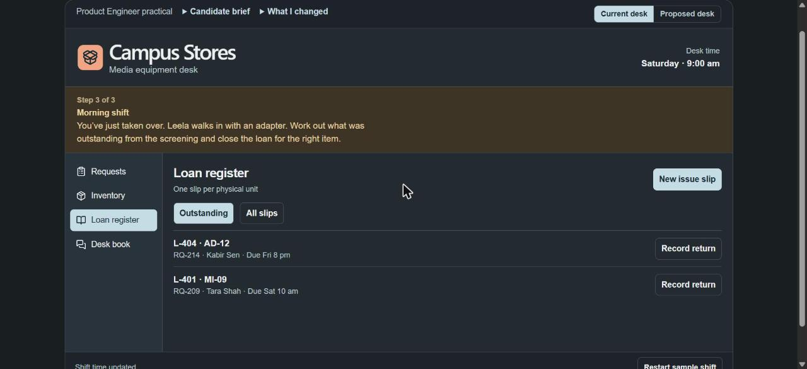
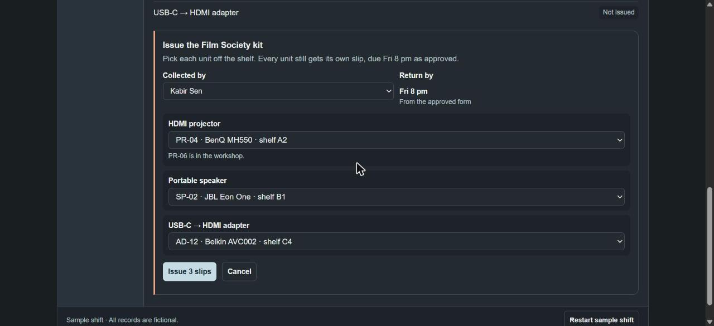
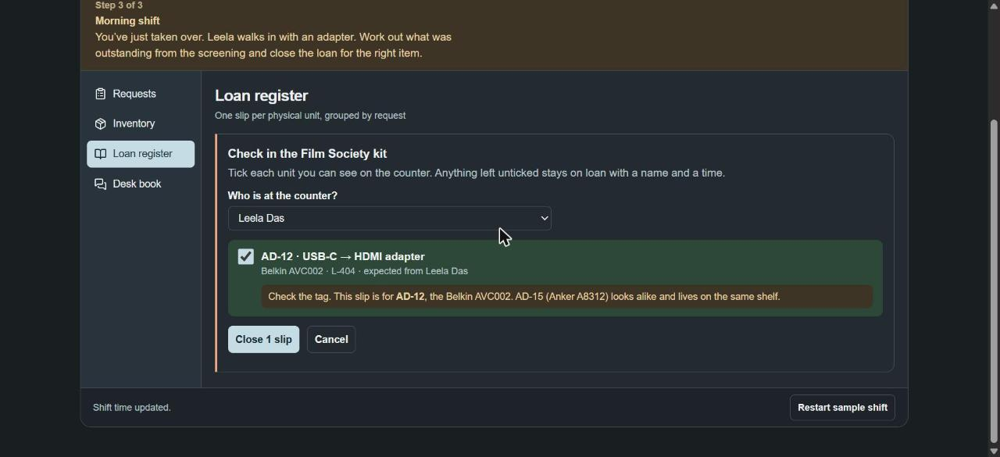

# Campus Stores

Campus Stores is a Product Engineer work sample set at a fictional campus media equipment desk. Work through a club’s screening, from equipment pickup to a partial return and the next morning’s handover. Open **Candidate brief** in the app for the assignment.

---

## My submission

**Decision: work the counter by kit, keep the register by unit.**

Clubs borrow kits, but this desk only lets you see and act on single slips. That is fine while everything leaves and comes back together. It breaks when a kit comes back in pieces, which is exactly what happened on this shift. I kept the one-slip-per-unit record and changed how the counter works with it: issue a kit in one step, check a kit in by ticking what is physically on the counter, and make anything still missing carry *who has it* and *when it is coming back* on the slip itself.

**Try it in 30 seconds:** open `index.html`. The switch in the top-right corner flips between **Current desk** (the original, untouched) and **Proposed desk** (my change). Both run on the same records, so you can do the same job both ways. **What I changed** in the top strip has the short version.

### The shift, worked on the current desk

| Time | What I did | What I noticed |
| --- | --- | --- |
| Fri 3:45 pm | Read the Desk book: Isha asked for the kit to go out in Kabir’s name. Issued PR-04, SP-02 and AD-12 to Kabir on three separate slips. | 3 forms × 4 dropdowns. The unit list isn’t filtered to the request, *Return by* isn’t taken from the approved form, and errors appear in the status bar at the bottom of the page. |
| Fri 7:30 pm | Kabir brought back the projector and speaker. Clicked **Record return** on L-402 and L-403. Wrote “Leela has the adapter, back 9 am” in the Desk book. | Nothing stopped me closing L-404 as well. One click, no confirmation, no undo, and the row vanishes from *Outstanding*. The note I wrote isn’t connected to the slip. |
| Sat 9:00 am | New shift. Leela walks in with an adapter. | The register says `L-404 · AD-12 · RQ-214 · Kabir Sen · Due Fri 8 pm`. Leela’s name isn’t on it, and it doesn’t say the slip is overdue. It also doesn’t say what AD-12 *is*. AD-12 (Belkin) and AD-15 (Anker) are both adapters on shelf C4. To close the right slip I had to read the Desk book, then open Inventory to learn which model AD-12 is. |



### One moment the product handles well

**At 3:45 pm it would not let me hand out the wrong thing.** On the issue slip I tried to add a second adapter to RQ-214 and got *“The approved quantity of this equipment type is already on loan.”* Putting the Photo Circle’s camera (CA-03) on the Film Society request was refused as outside the approved request. The projector in the workshop (PR-06) never appeared as an option. The register checks every unit against what the Student Activities Office actually approved. That is the part of this product I trust, and I kept all of it.

### One moment I would change

**At 9 am, closing “the loan for the right item” depended on a free-text note and my memory of shelf C4.** The handover from 7:30 pm lived in the Desk book, the slip still pointed at Kabir, and the register never named the adapter model. The right answer was in the system, split across three screens. And the night before, a single misclick on **Record return** could have closed L-404 with the adapter still in Leela’s bag.

### The change

| Step | Proposed desk |
| --- | --- |
| **Issue kit** (Requests → RQ-214) | One form for the whole approved request. Each line is preselected with an available unit and shows its model and shelf, so it doubles as a pick list. *Return by* comes from the approved form. *Collected by* stays a deliberate choice, and the request page shows Isha’s message right above it. Still one slip per unit: L-402, L-403, L-404. |
| **Check in** (Loan register) | Open slips are grouped by request. **Check in** asks *who is at the counter* and has you tick each unit you can actually see. Anything left unticked **must** get a name and a time (“Leela Das, Sat 9 am”) before you can save. The button says what will happen: *Close 2 slips, keep 1 open*. **Undo check-in** is in the status bar. |
| **Who’s at the counter?** | Search by person, club, slip or unit tag. It matches the borrower *and* the person bringing it back, so typing “Leela” finds L-404. |
| **Overdue and due soon** | Slips are compared with the desk clock. On Saturday morning, L-404 is *Overdue · was due Fri 8 pm* and the microphone is *Due Sat 10 am* (within the hour). |
| **Check the tag** | When a look-alike unit lives on the same shelf, check-in says so: *This slip is for AD-12, the Belkin AVC002. AD-15 (Anker A8312) looks alike and lives on the same shelf.* |
| **Desk book stays useful** | Every check-in writes its own entry (“Film Society kit: Kabir Sen returned PR-04 and SP-02. AD-12 (Belkin AVC002, slip L-404) is still out with Leela Das, expected Sat 9 am.”), so the history is still readable as a log. |

### The same job, on the proposed desk

**Fri 3:45 pm: pickup.** Requests → *Courtyard screening* → **Issue kit**. Isha’s note is on the page, so I pick Kabir and leave the preselected units. One click issues L-402 PR-04, L-403 SP-02 and L-404 AD-12, all due Fri 8 pm.



**Fri 7:30 pm: partial return.** Loan register → Film Society → **Check in**. Tick the projector and the speaker. The adapter stays unticked, so the form asks who has it: Leela Das, Sat 9 am. **Close 2 slips, keep 1 open.**


**Sat 9:00 am: handover.** I’ve never seen this kit. Leela says her name and I type “Leela”. The register shows L-404 *With Leela Das, bringing it back Sat 9 am*, flags it overdue, and names the Belkin on shelf C4.


**Check in** opens with Leela already selected (she’s the person on the slip). It reminds me the Anker on the same shelf is not this one. I check the tag on the adapter in her hand, tick it and **Close 1 slip**.



### What I kept, on purpose

- **One slip per physical unit.** Stock, repairs and loss are counted by unit. Kits are only how the counter *works*, not how the register *stores* things.
- **The approval checks** (type must be on the approved form, approved quantity, units in repair excluded). Issue kit runs the same rules.
- **The Desk book** for messages that aren’t about a slip. It now also receives check-ins automatically instead of depending on someone retyping them.
- **The single-unit issue slip** (*New issue slip*) for one-off swaps, like replacing a faulty speaker mid-event.
- **The visual language.** Same tokens, type and layout. New states only add warm “expected back” and red “overdue” tags.

### What I would watch at a real counter

**When the person returning an item isn’t the person on the slip, does the staff member close the right slip without opening the Desk book or asking the returner a question?**

Concretely: sit at the desk during a morning shift change for a week and note each delegated return. Count the ones where the staffer goes from name to closed slip using only the register. The other signal to watch is a stock-take where a unit shows *On shelf* but is physically missing, or the other way round. If that count drops, the change helped. If staff still reach for the Desk book first, then the expected-back line is in the wrong place or easy to skip.

### What I didn’t do, and the trade-offs

- **Ticking is still honour-based.** At a real counter I would want a barcode or QR scan on the tag instead of a checkbox. I kept that out because this prototype has no hardware to fake honestly.
- **Expected-back times are a fixed list** (Sat 9 am, 10 am, noon) to match the sample data. A real version needs a proper time picker and a reminder when the expected time passes.
- **Opening Check in pre-fills “who is at the counter”** from the slip. That speeds up the common case, but someone could save without looking. I’d watch for that in the observation above.
- **No backend.** State stays in `localStorage` like the original. I bumped the storage key to `v2` so older saved shifts can’t load into the new shape.

### What changed in the code

- `app.js`: original screens kept as **Current desk**. Added the **Proposed desk** request page (issue kit, request messages, kit status) and the register (grouping, lookup, overdue, check-in with required follow-up, undo). Added the `expect`, `returnedBy` and `returnedAt` fields on loans and the auto check-in note.
- `index.html`: desk version switch, *What I changed* panel, step counter, undo button.
- `styles.css`: styles for the new states, reusing the existing tokens. It also handles narrow screens and respects reduced motion.
- `docs/`: screenshots used above.

Built with Claude Code as a pair. The brief allows AI tools. The decision, the shift walkthrough and the trade-offs are mine.

---

## Run the app

Open `index.html` in a modern browser. The app includes its scripts, styles, and icons and can run offline.

To serve it over local HTTP, run this from the repository folder and visit `http://localhost:8000`.

```sh
python3 -m http.server 8000 --bind 127.0.0.1
```

Each browser stores its own sample shift locally when browser storage is available. **Restart sample shift** restores the fictional starting records.

## Source

- `index.html` contains the desk layout, candidate brief, and bundled icons.
- `app.js` contains the sample records and interactions.
- `styles.css` defines the desktop and mobile layouts.

Icon license notices are in [third-party/lucide-LICENSE.txt](third-party/lucide-LICENSE.txt).


## Submit your work

1. [Fork Campus Stores](https://github.com/virinchi-healthcare/campus-stores/fork) into your GitHub account. Complete the candidate brief and push your changes to your public fork. In your README, point reviewers to your work and explain the decision you made.
2. In your fork, open **Commits**, select the final commit you want reviewed, and copy the page URL. It should look like `https://github.com/YOUR-USERNAME/campus-stores/commit/COMMIT-SHA`.
3. [Submit your work through the Google Form](https://docs.google.com/forms/d/e/1FAIpQLScvzoh1R4WS-SkiwAVBQbMvniieJYSoOEfLMyVo5CyjOvYUgQ/viewform). Your **roll number**, **email ID**, and **final commit link from your public fork** are required. Enter your roll number and email ID in the form only.
