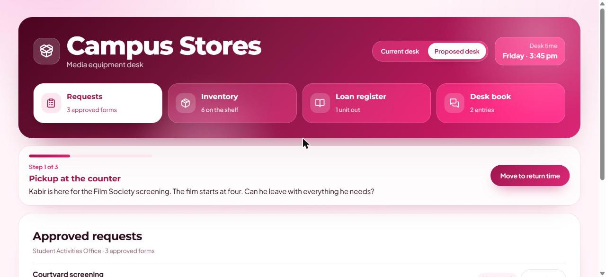
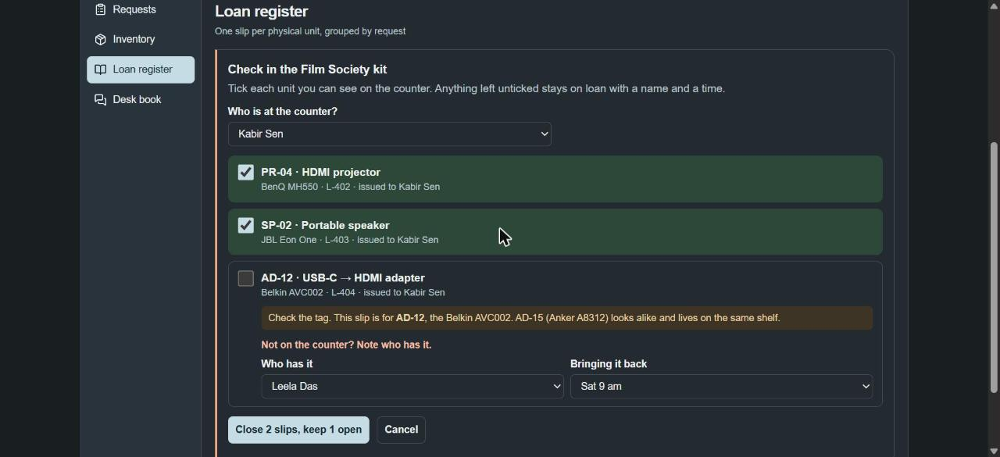
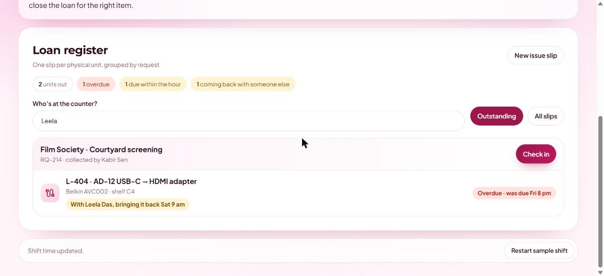

# Campus Stores

A campus media equipment desk, built for the Product Engineer work sample. It has two parts:

1. **The desk** (`index.html`): my answer to the candidate brief, run on the original Film Society shift.
2. **The club and admin portal** (`portal.html`): role-based dashboards for requests, handovers between clubs and condition sign-off.

## How to open it

| | Live (nothing to install) | Locally |
| --- | --- | --- |
| Desk | **https://rashidcmm.github.io/campus-stores/** | open `index.html` |
| Portal | **https://rashidcmm.github.io/campus-stores/portal.html** (or **Club & admin sign in** in the desk header) | open `portal.html` |

If a page looks out of date, press **Ctrl + Shift + R**. All data is sample data stored in your browser. **Restart sample shift** and **Reset demo data** put it back.

---

## 1. The desk: my answer to the brief

**Decision: work the counter by kit, keep the register by unit.**

Use the **Current desk / Proposed desk** switch in the header to run the same shift both ways. Move time forward with the button on the shift card: 3:45 pm pickup, then 7:30 pm partial return, then 9 am handover.

- **What the product handles well:** at pickup it refuses anything outside the approved request. Issuing a second adapter gives *“approved quantity already on loan”*. The camera is refused on the Film Society form. The projector in repair is never offered. I kept all of this.
- **What I changed:** at 9 am the slip said `L-404 · AD-12 · Kabir Sen`. Leela, who was returning it, wasn’t on it, and it didn’t say which of the two look-alike adapters on shelf C4 was out. The handover lived in a free-text note, and one misclick on *Record return* could have closed the wrong slip.
- **The fix (proposed desk):**
  - **Issue kit:** the whole approved request goes out from one form, still one slip per unit.
  - **Check in:** tick what is physically on the counter. Anything missing must say *who has it and when it’s coming back*.
  - **Who’s at the counter?:** typing “Leela” finds the slip.
  - **Overdue tags.**
  - **A same-shelf warning:** *“AD-15 looks alike and lives on the same shelf”*.
  - **Undo.**
- **What I’d watch at a real counter:** when someone other than the borrower returns an item, does staff close the right slip without opening the Desk book or asking a question?

| 7:30 pm: partial check-in | 9 am: search by the returner’s name |
| --- | --- |
|  |  |

---

## 2. The portal: clubs and admin

On the sign-in page, click a **role card** for one-click sign-in (each card lists what to try), or type a login. Every dashboard already has sample data to act on.

| Login | Role | Try this |
| --- | --- | --- |
| `admin` / `admin123` | Admin | Approve Film Society’s requests by choosing a unit. Approve Tara’s extension. Record condition at pickup and return. Approve the adapter handover. Resolve issues. Add a unit with a product photo |
| `dev` / `photo123` | Photo Circle | Agree the tripod’s condition at pickup. Film Society wants your camera mid-loan: accept it and record its condition with a note and photo |
| `isha` / `film123` | Film Society | Agree or dispute the adapter’s return condition. Agree the camera’s condition once Photo Circle records it. Request gear |
| `tara` / `debate123` | Debate Union | Track your extension, the speaker you reported before pickup, and your adapter handover |

**Features**
- **Requests:** a club can book up to 30 days ahead, for up to 14 days. The admin approves by allocating a unit that is free on those dates, or declines with a reason. Clubs can ask to extend by up to 7 days.
- **Condition sign-off (nothing counts until both sides agree):**
  - **At pickup and return:** the admin records the condition (rating, note, optional photo), and the club agrees or disputes.
  - **Club to club:** the holding club records the condition, the receiving club agrees, then the admin approves.
  - **Disputes:** a dispute opens an issue report automatically.
- **Handover mid-loan:** a club can borrow a unit another club already has, for part of that club’s booking. The booking shows who holds it now.
- **Issues:** report a fault before pickup (so you aren’t blamed) or during a loan, with a photo. The admin resolves it or sends the unit to repair.
- **Inventory (admin):** add units (with a photo), remove units, and send units to repair or back into service.

This is a front-end demo: the accounts are fixed and data stays in the browser. A real version would put the same records behind a database, real sign-in and an audit log.

---

## Files

- `index.html`, `app.js`, `styles.css`: the desk. The original screens are kept under **Current desk**.
- `portal.html`, `portal.js`, `portal.css`: the club and admin portal.
- `docs/`: screenshots.

## Submit your work

1. [Fork Campus Stores](https://github.com/virinchi-healthcare/campus-stores/fork) into your GitHub account. Complete the candidate brief and push your changes to your public fork. In your README, point reviewers to your work and explain the decision you made.
2. In your fork, open **Commits**, select the final commit you want reviewed, and copy the page URL. It should look like `https://github.com/YOUR-USERNAME/campus-stores/commit/COMMIT-SHA`.
3. [Submit your work through the Google Form](https://docs.google.com/forms/d/e/1FAIpQLScvzoh1R4WS-SkiwAVBQbMvniieJYSoOEfLMyVo5CyjOvYUgQ/viewform). Your **roll number**, **email ID**, and **final commit link from your public fork** are required. Enter your roll number and email ID in the form only.
